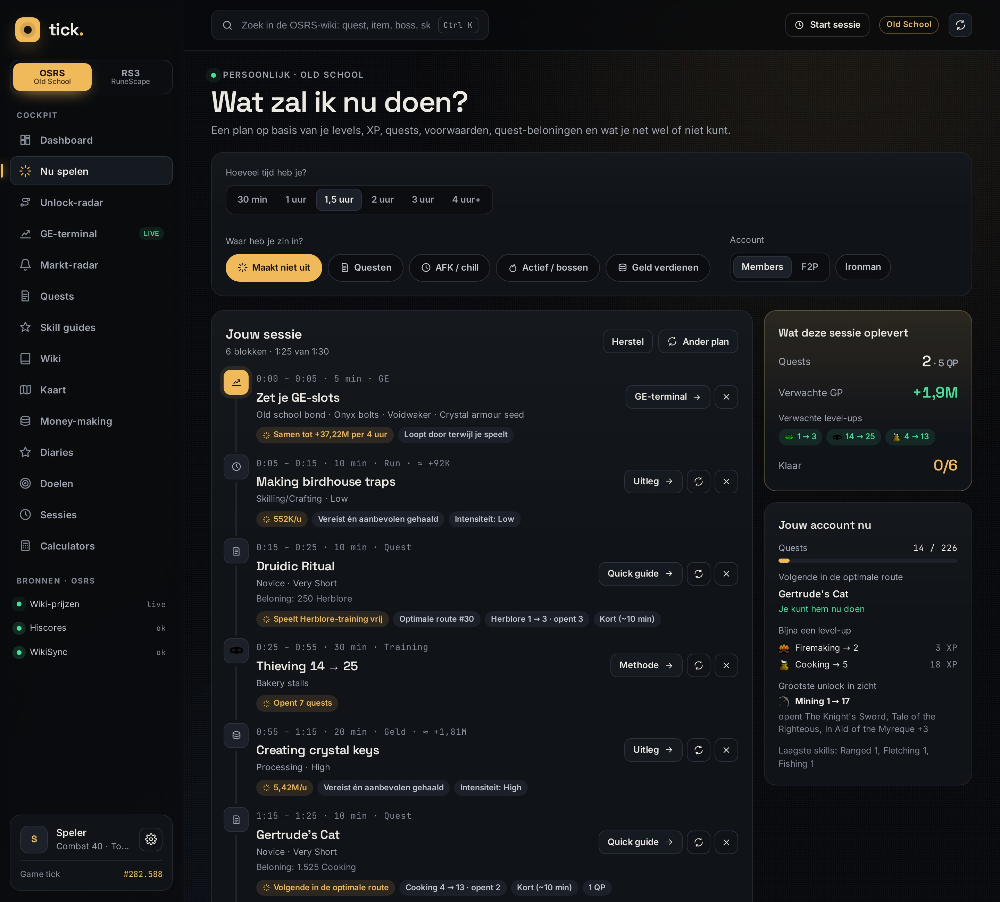
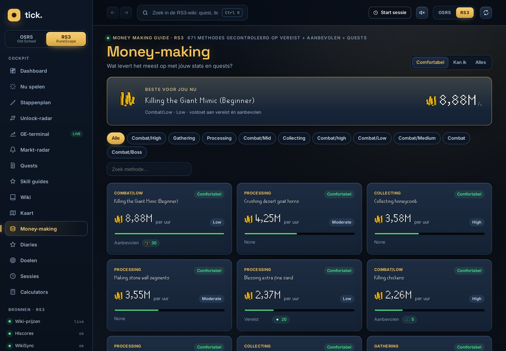
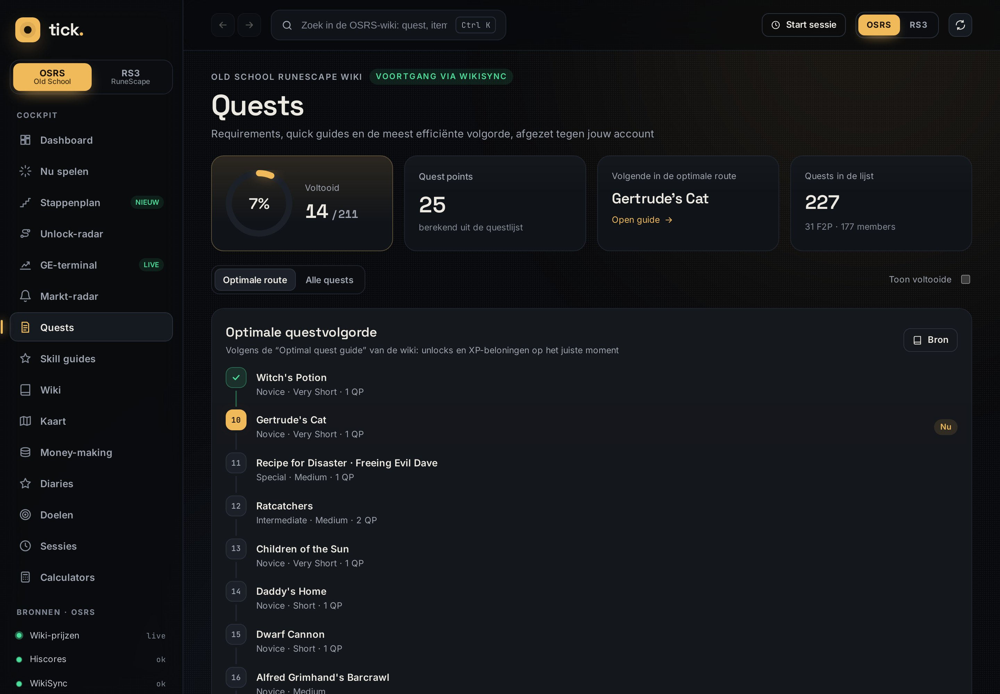
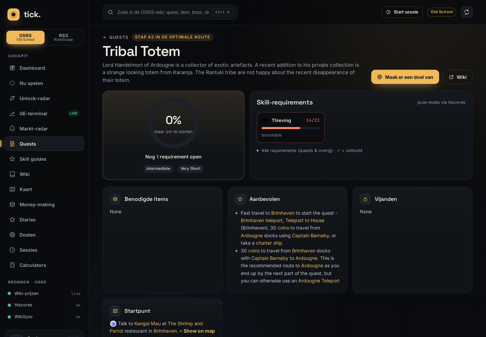
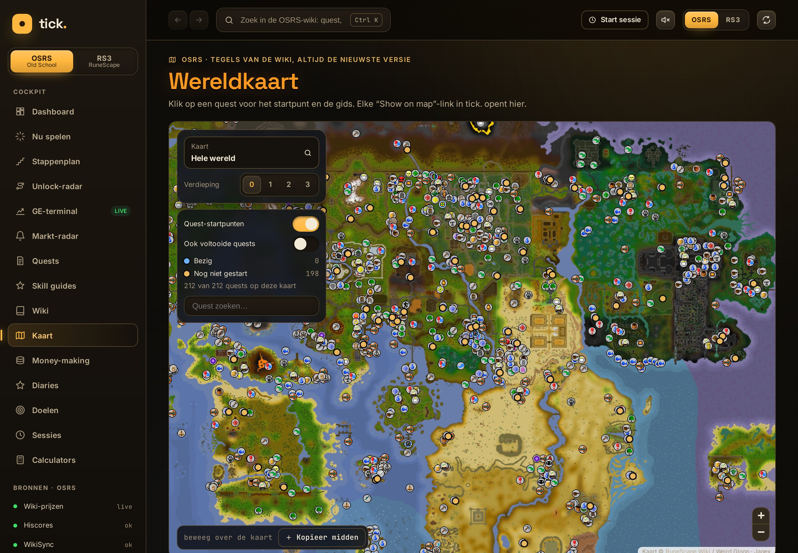
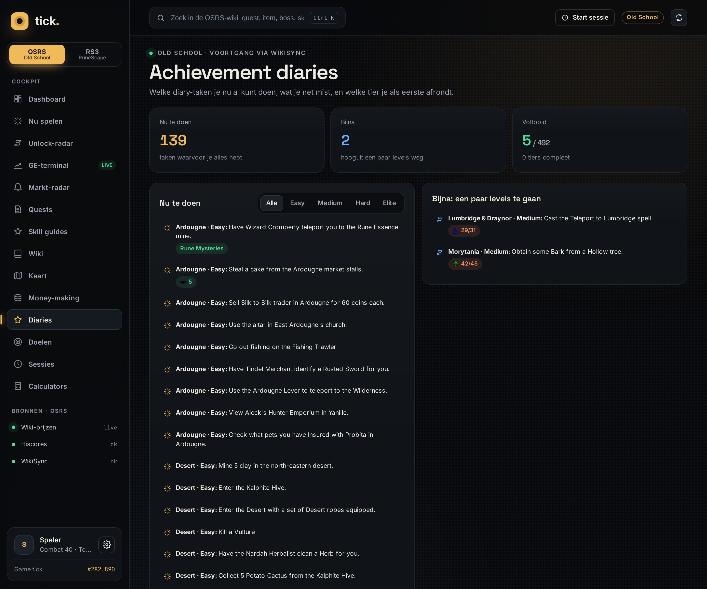
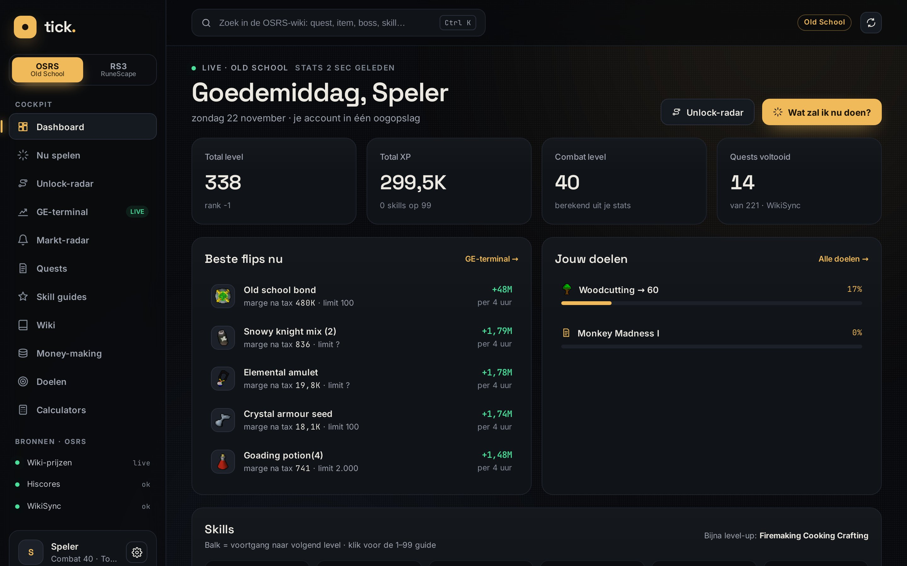

<div align="center">


# tick.

**Je persoonlijke cockpit voor Old School RuneScape én RuneScape 3.**
De wiki weet alles over RuneScape, de game weet alles over jou. tick. koppelt die twee,
zodat je niet meer zoekt, maar gewoon ziet wat je nú kunt en moet doen.

[**⬇ Download voor Windows**](https://github.com/yuus27/tick-rs/releases/latest) &nbsp;·&nbsp; [Wat kan het?](#wat-kan-tick) &nbsp;·&nbsp; [Installeren](#installeren) &nbsp;·&nbsp; [Vragen](#veelgestelde-vragen)



</div>

---

## Wat is tick.?

Een desktop-app die je naast RuneLite of de RS3-client open hebt. Je vult je RuneScape-naam in en tick. haalt je levels, XP en questvoortgang op. Daarna legt het **jouw account** over de complete RuneScape Wiki heen: quests, voorwaarden, skill guides, money-making en live Grand Exchange-prijzen.

Het resultaat: geen tien browsertabs en zelf eisen vergelijken meer. Je krijgt antwoorden die op jou van toepassing zijn.

| De vraag die je jezelf stelt | Zonder tick. | Met tick. |
|---|---|---|
| *"Wat zal ik vandaag doen?"* | Wiki openen, quests vergelijken met je stats, voorwaarden nalopen, skill guides lezen | Kies *"1,5 uur, chill"* en krijg een plan, met per blok waaróm |
| *"Hoe verdien ik geld met mijn stats?"* | 500+ methodes, inclusief bosses met 99-eisen | Alleen wat jij kunt, en of je onder de aanbevolen levels zit |
| *"Welke quest kan ik nu doen?"* | Per quest de eisen en voorwaarden-boom checken | Al gecheckt, in de optimale volgorde, met de level-ups die hij oplevert |
| *"Waar train ik naartoe?"* | Zelf uitzoeken welke levels iets openen | *"Thieving 14 → 25 opent 7 quests"*, met de beste methode voor jouw level |
| *"Is dit een goede flip?"* | Prijs en een simpele grafiek | Marge ná GE-tax, buy limits, volume, winst per 4 uur, marktalarmen |

> **Geen bot.** tick. leest alleen openbare data (wiki, hiscores, WikiSync) en doet niets in de game.

---

## Wat kan tick.?

### 🎯 Nu spelen: je persoonlijke adviseur
Kies hoeveel tijd je hebt en waar je zin in hebt (questen, AFK, bossen, geld) en tick. maakt een sessieplan. Het weegt mee:
- **quests die je echt kunt doen**, inclusief de voorwaarden-boom van elke quest;
- **quest-XP**: quests die je een level opleveren of iets vrijspelen krijgen voorrang;
- **training per level**: de methode uit de skill guide die bij jóuw level hoort, met XP/uur en een tijdsinschatting;
- **combo's**: *"train Mining 1 → 10, doe dan meteen The Knight's Sword"*;
- **bijna-level-ups**, money-methodes die bij je passen, runs en je GE-slots;
- **members/F2P en ironman** (geen GE-flips of koopmethodes voor ironmen).

Wissel, verwijder of voeg blokken toe tot het plan klopt.

### 💰 Money-making op jouw stats


De volledige money making guide van de wiki, gefilterd op wat jouw account kan. tick. leest per methode wat **vereist** is en wat **aanbevolen**, inclusief "of"-eisen (*Attack, Ranged, Magic óf Necromancy 90*), combat level en quests. Je ziet direct: *comfortabel*, *net onder aanbevolen*, *ver onder aanbevolen* of *locked*.

### 📜 Quests en quest guides
<table><tr>
<td width="50%"></td>
<td width="50%"></td>
</tr></table>

De **optimale questroute** van de wiki met jouw voortgang, en per quest een requirements-paneel: jouw levels naast wat vereist is, boostable-eisen, quest-voorwaarden ✓/✗, items en startpunt. Daaronder de **quick guide** én de volledige guide, gewoon in de app.

### 📈 Skill guides 1–99


Per skill de trainingsroute in meerdere varianten: **Pay-to-play, Free-to-play, Ironman, Questing** (welke quests XP geven) en een overzicht. De route laat zien waar jij nu zit.

### 🔓 Unlock-radar


Welke paar levels openen de meeste quests en money-methodes? tick. rekent het uit en sorteert op "meeste nieuwe content per XP".

### 📊 GE-terminal en Markt-radar
<table><tr>
<td width="50%"></td>
<td width="50%"></td>
</tr></table>

- **GE-terminal:** flip finder met marge ná tax, ROI, buy limits en realistische winst per 4 uur, grafieken, een watchlist met prijsalerts en een flip-journaal (importeert ook uit **Flipping Utilities**).
- **Markt-radar:** detecteert ongewone marktbewegingen (volumepieken, prijssprongen en -crashes, mogelijke pumps en dumps) tegen een baseline van 24 uur.

### 📚 De complete wiki, in de app


Zoek met **Ctrl+K** in de OSRS- of RS3-wiki; elke link opent gewoon in tick.

### 🗺️ Wereldkaart <sub>vanaf 0.4.2</sub>


De kaart van de wiki, ingebouwd en altijd de nieuwste versie: de hele wereld plus alle kerkers en verdiepingen. Elke **"Show on map"**-link in tick. opent hier met een pin. Alle **quest-startpunten** staan erop, gekleurd naar jouw voortgang; klik er een aan voor het startpunt en de quest-gids.

### 🏅 Achievement diaries <sub>vanaf 0.4.2 · OSRS</sub>


Alle diary-taken van de 12 regio's naast jouw levels, quests en voortgang (via WikiSync). tick. laat zien welke taken je **nu** kunt doen, welke je **bijna** kunt (een paar levels, of boostable), en welke tier je het snelst afrondt voor de beloning.

### ⏱️ Sessies <sub>vanaf 0.4.2</sub>


Klik op *Start sessie* als je gaat spelen. Na afloop zie je wat het opleverde: XP per skill, levels, voltooide quests en je GE-winst. Elke sessie wordt bewaard, zodat je ziet welke avonden het meest opleverden.

### En verder
- **Dashboard** met je stats, beste flips, doelen en de laatste game-updates.
- **Doelen** voor skills en quests, opgeknipt in stappen, met een streak.
- **Calculators:** *kopen of grinden* (in uren van jóuw tijd), XP, drop-kansen, GE-tax, combat level.
- **Altijd bovenop** (Ctrl+Shift+T): handig op een tweede scherm naast de game.

### OSRS én RS3
<table><tr>
<td width="50%"></td>
<td width="50%"></td>
</tr></table>

Wissel met één klik tussen Old School en RuneScape 3; alle schermen schakelen mee.

---

## Installeren

1. Download **`tick-setup-x.y.z.exe`** van de [releases-pagina](https://github.com/yuus27/tick-rs/releases/latest).
   *Liever zonder installatie? Neem `tick-portable-x.y.z.exe` (werkt niet automatisch bij).*
2. Windows toont de eerste keer *"Windows heeft uw pc beschermd"*, omdat de app niet ondertekend is. Klik **Meer informatie → Toch uitvoeren**.
3. Open **Instellingen** en vul je RuneScape-naam in (OSRS en/of RS3).
4. Koppel je questvoortgang met **WikiSync**:
   - **OSRS:** installeer de plugin *WikiSync* in RuneLite (Plugin Hub) en log één keer in.
   - **RS3:** in de RS3-client: toolbox-icoon → **Plugin Hub** → zoek *WikiSync* → Install, en zet hem aan bij *Manage*. Log één keer in.

   Zonder WikiSync werken levels, prijzen en guides gewoon; je quests vink je dan zelf af op de Quests-pagina.

### Updates
De geïnstalleerde app zoekt bij het opstarten en elke 4 uur naar een nieuwe versie, downloadt die op de achtergrond en vraagt of je wilt herstarten. Je data blijft altijd bewaard. Handmatig zoeken: tray-icoon → *Zoek naar updates*, of **Instellingen → Updates**.

---

## Veelgestelde vragen

**Is dit niet gewoon wat al in de game en op de wiki staat?**
De data komt inderdaad van de wiki en de game. Wat tick. toevoegt, is de **combinatie met jouw account**: het legt quest-eisen, voorwaarden, quest-XP, skill guides en money-making over elkaar heen en filtert op wat jij kunt. Dat doet niemand handmatig. Losse tools zoals Quest Helper of Flipping Utilities blijven nuttig; tick. is de laag erboven die alles samenbrengt.

**Is het veilig? Kan ik gebanned worden?**
tick. leest alleen openbare data en verandert niets aan je game of client. Het is geen plugin en geen bot.

**Wat gebeurt er met mijn data?**
Alles blijft op je eigen pc (`%APPDATA%\tick\data`). Er is geen account, geen server van ons en geen tracking. tick. draait een kleine lokale server op `127.0.0.1` die alleen praat met een vaste lijst bronnen: de wiki's, de wiki-prijzen-API, de officiële hiscores en WikiSync. De kaarttegels komen rechtstreeks van de wikikaart (maps.runescape.wiki).

**Werkt het op Mac of Linux?**
De kant-en-klare app is er (nog) alleen voor Windows. Vanaf de broncode draait tick. overal waar Node.js draait (zie hieronder).

**Iets werkt niet goed?**
Ga naar **Instellingen → Diagnose**, klik op *Kopieer rapport* en open een [issue](https://github.com/yuus27/tick-rs/issues) of stuur het rapport door.

---

<details>
<summary><b>Voor ontwikkelaars</b></summary>

### Zelf draaien vanuit de broncode
1. Installeer **Node.js LTS** (https://nodejs.org).
2. `start-tick.bat` (browserversie op `http://localhost:5177`) of `desktop-testen.bat` (desktopvenster). Hot reload: `npm run dev`.
3. Zelf een .exe bouwen: `desktop-bouwen.bat` (komt in `release/`).

### Nieuwe versie uitbrengen
Verhoog `version` in `package.json` en push naar `main`. De workflow **Release** bouwt op Windows de installer + portable en publiceert ze met `latest.yml` (voor auto-update) in GitHub Releases. De workflow **Screenshots** ververst de afbeeldingen in deze README (handmatig te starten via Actions).

### Structuur
```
server/index.js     lokale server: allowlist-proxy, cache, opslag
electron/           desktop-app: venster, tray, auto-update
web/src/lib         games.js (OSRS/RS3-verschillen), wiki.js (parsen), intel.js + advisor.js (adviseur),
                    mmg.js (money-making), market.js (GE), xp.js, map.js (kaart),
                    diaries.js (achievement diaries), session.js (sessierapport)
web/src/pages       alle schermen
docs/               screenshot-script
```

### Diagnose
`#/diag` test alle wiki-uitlezing, prijzen en je account en maakt een rapport om te kopiëren.

</details>

---

<sub>tick. is een fanproject en is niet gelieerd aan, gesponsord door of goedgekeurd door Jagex Ltd. RuneScape en Old School RuneScape zijn handelsmerken van Jagex Ltd. Wiki-inhoud is afkomstig van de [RuneScape Wiki](https://runescape.wiki) en de [Old School RuneScape Wiki](https://oldschool.runescape.wiki) (CC BY-NC-SA 3.0). Prijsdata via de [Real-time Prices API](https://prices.runescape.wiki). Kaarttegels van de wikikaart (Weird Gloop).</sub>
